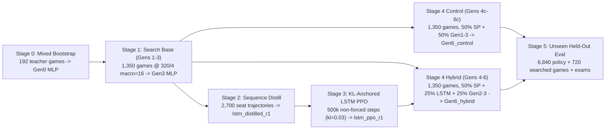

# EX13 Small-Pool Hybrid Search ↔ LSTM PPO Campaign Results

**Branch:** `feat/small-pool-hybrid-search-lstm-ppo` (based on `main` @ `53bd2736`)  
**Run Directory:** `runs/ex13-small3-hybrid/`  
**Contracts Preserved:** `standard_lite_v2` (`9,434` floats, schema `standard_lite_v2.4`), `ACTION_SPACE_SIZE = 2192` (action schema `2`), **zero truncations** across all `4,050` self-play training games, `6,840` held-out policy evaluation games, and `720` held-out `320/4` searched evaluation games.

> [!IMPORTANT]
> **Headline Result:** Warm-starting recurrent PPO from MCTS sequence distillation (`Gen3 -> lstm_distilled_r1 -> lstm_ppo_r1`) produced the **strongest standalone policy in the entire campaign** — hitting **`99.7%` (`359–1–0`)** vs `greedy`, **`76.9%` (`277–83–0`)** vs `development_v1`, and beating the `Gen3` search-trained MLP **`59.7%` (`CI [54.7%, 64.7%]`)** and `Gen6_hybrid` MLP **`58.1%` (`CI [52.8%, 63.1%]`)** policy-to-policy on unseen held-out decklists, while averaging **`5.84` digivolutions/game**. Meanwhile, pairing `Gen6_hybrid` with online `320/4` search defeated policy-only `lstm_ppo_r1` **`80.0%` (`144–36–0`)**, and hybrid sparring against `lstm_ppo_r1` **prevented the catastrophic Examon `<Training>` value collapse** seen in pure-search control (`8/8` seeds passed in `Gen6_hybrid` vs `0/8` in `Gen6_control`).

---

## 1. Pipeline Architecture & Experimental Design

The campaign tested bidirectional coupling between **Macro-Substep PIMC-MCTS** ([`mcts.rs`](file:///home/antigravity/mammalwithashell/digimon-deck-list-builder/code/digimon-engine/src/search/mcts.rs), [`batched.rs`](file:///home/antigravity/mammalwithashell/digimon-deck-list-builder/code/digimon-engine/src/search/batched.rs)) and **KL-Anchored Clean-Reward `MaskableRecurrentPPO`** ([`maskable_recurrent_ppo.py`](file:///home/antigravity/mammalwithashell/digimon-deck-list-builder/code/digimon_gym/agents/maskable_recurrent/maskable_recurrent_ppo.py), [`azero_lstm_distill.py`](file:///home/antigravity/mammalwithashell/digimon-deck-list-builder/code/digimon_gym/agents/azero_lstm_distill.py)) on the frozen 3-archetype pool ([`manifest.json`](file:///home/antigravity/mammalwithashell/digimon-deck-list-builder/data/training_pools/ex13-small3/manifest.json): **Examon**, **TS Jupitermon**, **Three Musketeers**; `6` training lists + `6` strictly disjoint held-out lists, zero card substitutions).

All playing-strength claims below come exclusively from **seat-balanced unseen held-out deck evaluations** (`heldout_snapshot.json` / `heldout_decks.json`) with paired play/draw seeds and 95% paired bootstrap confidence intervals implemented in [`run_hybrid_small_campaign.py`](file:///home/antigravity/mammalwithashell/digimon-deck-list-builder/code/tools/run_hybrid_small_campaign.py).

---

## 2. Unseen Held-Out Policy-Only Evaluation (`360` Games / Matchup)

Each row evaluates **`360` games** (`180` seat-balanced play/draw seed pairs, `120` games per candidate archetype) on the `6` unseen held-out lists with no test-time search (`skip_forced=True` for recurrent policies, `reset()` at every episode boundary).

### 2.1 Progression Against Heuristic Anchors

| Checkpoint | Architecture | vs `greedy` WR (95% Paired CI) | vs `development_v1` WR (95% Paired CI) | Mean Turns (vs `dev_v1`) | Mean Agent Digivolves / Game |
|---|---|---:|---:|---:|---:|
| **`Gen0`** | `[256, 256]` MLP (Bootstrap) | `66.9%` (`[61.9%, 71.9%]`, `241–119`) | `46.4%` (`[41.4%, 51.4%]`, `167–193`) | `10.47` | `2.96` |
| **`Gen3`** | `[256, 256]` MLP (3 Search Gens) | `94.4%` (`[91.9%, 96.7%]`, `340–20`) | `71.1%` (`[66.4%, 75.8%]`, `256–104`) | `9.25` | `4.49` |
| **`lstm_distilled_r1`** | `[256, 256]` + `256` LSTM (Distill) | `96.1%` (`[94.2%, 98.1%]`, `346–14`) | `70.8%` (`[65.8%, 75.6%]`, `255–105`) | `9.01` | `4.71` |
| **`lstm_ppo_r1`** | `[256, 256]` + `256` LSTM (PPO) | **`99.7%`** (`[99.2%, 100.0%]`, `359–1`) | **`76.9%`** (`[72.8%, 81.1%]`, `277–83`) | `9.31` | **`5.33`** |
| **`Gen6_control`** | `[256, 256]` MLP (+3 Pure Search Gens) | `97.2%` (`[95.3%, 98.9%]`, `350–10`) | `73.9%` (`[69.4%, 78.3%]`, `266–94`) | `9.18` | `4.90` |
| **`Gen6_hybrid`** | `[256, 256]` MLP (+3 Hybrid Search Gens) | `97.2%` (`[95.3%, 98.9%]`, `350–10`) | `70.8%` (`[65.8%, 75.8%]`, `255–105`) | `9.10` | `4.72` |

#### Per-Archetype Held-Out Policy Win Rates vs `development_v1` (`120` Games / Cell)

| Checkpoint | Examon (`120` games) | TS Jupitermon (`120` games) | Three Musketeers (`120` games) |
|---|---:|---:|---:|
| **`Gen0`** | `42.5%` (`51–69`) | `56.7%` (`68–52`) | `40.0%` (`48–72`) |
| **`Gen3`** | `70.0%` (`84–36`) | `76.7%` (`92–28`) | `66.7%` (`80–40`) |
| **`lstm_distilled_r1`** | `72.5%` (`87–33`) | `75.8%` (`91–29`) | `64.2%` (`77–43`) |
| **`lstm_ppo_r1`** | **`75.0%`** (`90–30`) | **`80.0%`** (`96–24`) | **`75.8%`** (`91–29`) |
| **`Gen6_control`** | `73.3%` (`88–32`) | `78.3%` (`94–26`) | `70.0%` (`84–36`) |
| **`Gen6_hybrid`** | `73.3%` (`88–32`) | `75.0%` (`90–30`) | `64.2%` (`77–43`) |

---

### 2.2 Policy-Only Direct Head-to-Heads (`360` Games = `180` Seat-Balanced Pairs Each)

| Matchup (`Candidate` vs `Opponent`) | Candidate WR | 95% Paired CI | W–L–D | Examon | TS Jupitermon | Three Musketeers | Digivolves (Cand vs Opp) |
|---|---:|---:|---:|---:|---:|---:|---:|
| **`Gen3` vs `Gen0`** | **`68.6%`** | `[63.6%, 73.3%]` | `247–113–0` | `69.2%` | `80.8%` | `55.8%` | `5.08` vs `3.33` |
| **`lstm_ppo_r1` vs `lstm_distilled_r1`** | **`60.8%`** | `[55.8%, 65.8%]` | `219–141–0` | `58.3%` | `70.0%` | `54.2%` | `5.64` vs `5.14` |
| **`lstm_ppo_r1` vs `Gen3`** | **`59.7%`** | `[54.7%, 64.7%]` | `215–145–0` | `56.7%` | `68.3%` | `54.2%` | `5.59` vs `4.91` |
| **`Gen6_hybrid` vs `lstm_ppo_r1`** | `41.9%` *(LSTM wins **`58.1%`**)* | `[36.9%, 47.2%]` | `151–209–0` | `40.0%` | `56.7%` | `29.2%` | `5.49` vs **`5.84`** |
| **`Gen6_control` vs `Gen3`** | **`54.7%`** | `[49.4%, 60.0%]` | `197–163–0` | `45.8%` | `70.8%` | `47.5%` | `5.48` vs `4.92` |
| **`Gen6_hybrid` vs `Gen3`** | **`53.9%`** | `[48.6%, 59.2%]` | `194–166–0` | `51.7%` | `68.3%` | `41.7%` | `5.19` vs `4.71` |
| **`Gen6_hybrid` vs `Gen6_control`** | **`51.7%`** | `[46.4%, 56.9%]` | `186–174–0` | `36.7%` | `62.5%` | `55.8%` | `5.42` vs `5.60` |

> [!TIP]
> **Why `lstm_ppo_r1` Dominated Every Feed-Forward Policy:** Sequence distillation ([`azero_lstm_distill.py`](file:///home/antigravity/mammalwithashell/digimon-deck-list-builder/code/digimon_gym/agents/azero_lstm_distill.py)) transferred `Gen1–3` MCTS targets into `lstm_distilled_r1` with **zero cold-start loss** (`heldout policy_ce = 0.9409`, `96.1%` vs `greedy`). From there, `500,000` non-forced steps of clean terminal reward (`terminal_strategic_v1`) + forward KL anchoring (`kl_coef = 0.03`, steady `anchor_kl ≈ 0.20`) + `AutoAdvanceForcedWrapper` unlocked genuine multi-turn stack-building (`5.59–5.84` digivolutions/game) and hidden-zone memory (hand/trash/reveal history across turns) that a memoryless `[256, 256]` MLP cannot represent. Its largest edge over `Gen6_hybrid` MLP (`70.8%` LSTM win rate in **Three Musketeers**) occurs in the exact archetype most dependent on tracking option/trash sequencing across turns.

---

## 3. Unseen Held-Out `320/4` Searched Head-to-Heads (`180` Games = `90` Pairs Each)

Evaluated via native Rust [`digimon-engine-cli`](file:///home/antigravity/mammalwithashell/digimon-deck-list-builder/code/digimon-engine-cli/src/selfplay.rs) at `320` simulations, `4` determinized worlds, `eval_batch_size = 4`, `--macro-substeps 16`, `--reduced-sims 64`, `temperature = 0` (`--exploit-after-step 0`) on `heldout_decks.json`.

| Searched Matchup (`Seat A` vs `Seat B`) | Seat A Mode | Seat B Mode | Seat A WR | 95% Paired CI | W–L–D | Trunc | Examon | TS Jupitermon | Three Musketeers |
|---|---|---|---|---:|---:|---:|---:|---:|---:|
| **`Gen6_hybrid` vs `lstm_ppo_r1`** | `320/4` Search | `policy_lstm` | **`80.0%`** | `[74.4%, 85.6%]` | `144–36–0` | `0` | `66.7%` | `83.6%` | `87.1%` |
| **`Gen6_hybrid` vs `Gen6_control`** | `320/4` Search | `320/4` Search | **`50.6%`** | `[42.8%, 58.3%]` | `91–89–0` | `0` | `42.6%` | `62.5%` | `45.8%` |
| **`Gen6_control` vs `Gen3`** | `320/4` Search | `320/4` Search | `48.3%` | `[41.7%, 55.0%]` | `87–93–0` | `0` | `41.2%` | `68.5%` | `37.9%` |
| **`Gen6_hybrid` vs `Gen3`** | `320/4` Search | `320/4` Search | `47.2%` | `[39.4%, 55.0%]` | `85–95–0` | `0` | `42.2%` | `58.3%` | `38.1%` |

**Key Takeaways from Searched Evaluation:**
1. **`+38.1%` Real-Time Search Lift Against `lstm_ppo_r1`:** Turning on `320/4` PIMC-MCTS flips `Gen6_hybrid` from `41.9%` (policy-only) to **`80.0%`** (`144–36–0`) against `lstm_ppo_r1`. Immediate tactical combat/removal/lethal calculation from tree search remains decisively complementary to recurrent policy play.
2. **Symmetric `320/4` Search Saturation on Feed-Forward `[256, 256]` MLPs:** While `Gen6_hybrid` and `Gen6_control` both improved raw policy strength over `Gen3` (`53.9%` and `54.7%` policy H2H; `97.2%` vs `94.4%` vs `greedy`), under full `320/4` tree search `Gen3`, `Gen6_control`, and `Gen6_hybrid` sit within statistical parity (`47.2%–50.6%`, all 95% CIs spanning `50%`), with Stage-4 gains concentrated in **TS Jupitermon** (`58.3%–68.5%` over `Gen3`) offset by slight drift in Examon/Musketeers.

---

## 4. Tactical Diagnostics: Examon `<Training>` Search Exam

Graded via [`search_exam.rs`](file:///home/antigravity/mammalwithashell/digimon-deck-list-builder/code/digimon-engine/examples/search_exam.rs) on `qa/search-exams/ex13-examon-training-before-wingdramon.json` (`8` determinization seeds, `320` sims, `4` worlds):
- **Expectation 1:** Activate `Sprint Dash Training` `[Main]` (`[1002]`) receives `≥ 10%` of root visits.
- **Expectation 2:** Hard-playing `Wingdramon` from hand (`[4]`) is **never** chosen.

| Checkpoint | `--macro-substeps 0` (`[1002] ≥ 10%`, `[4]` avoided) | `--macro-substeps 16` (`[1002] ≥ 10%`, `[4]` avoided) | Value Trajectory Along `training_line` (`9` States) |
|---|---:|---:|---|
| **`Gen0`** (Bootstrap) | `8/8`, `8/8` | `4/8`, `8/8` | `+0.02 → +0.09 → -0.13 → +0.15 → -0.39 → -0.10 → -0.00 → +0.29 → -0.60` *(mid-effect valleys)* |
| **`Gen3`** (Search Base) | **`8/8`, `8/8`** | `4/8`, `8/8` | `+0.45 → +0.67 → +0.64 → +0.50 → +0.74 → +0.95 → +0.95 → +0.93 → +0.15` *(valleys cured)* |
| **`Gen6_control`** (Pure Search) | **`0/8`**, `8/8` *(collapsed!)* | **`0/8`**, `8/8` | **`-0.86 → -0.50 → -0.36 → -0.65 → -0.41 → -0.38 → -0.38 → -0.05 → -0.36`** *(pessimism collapse)* |
| **`Gen6_hybrid`** (Hybrid w/ LSTM) | **`8/8`, `8/8`** *(preserved!)* | `2/8`, `8/8` | **`+0.68 → +0.89 → +0.92 → +0.76 → +0.95 → +0.84 → +0.81 → +0.92 → +0.04`** *(strongest curve)* |

> [!NOTE]
> **Two High-Signal Diagnostic Discoveries:**
> 1. **Hybrid Sparring Prevented Closed-Pool Value Collapse (`8/8` vs `0/8`):** In `Gen6_control`, three additional generations of closed pure-search self-play caused Examon's value head on this board to collapse from `+0.45` (`Gen3`) to `-0.86`, dropping `Sprint Dash Training` (`[1002]`) below `10%` visits on **all `8/8` seeds**. In `Gen6_hybrid`, sparring `25%` of games against `lstm_ppo_r1` kept the value calibration healthy (`+0.68` root → `+0.95` mid-chain) and preserved **`8/8` (`100%`)** pass rate at `macro=0`.
> 2. **Why `macro=0` Beat `macro=16` on `Sprint Dash Training` (`[1002]`):** When `macro_substeps=16` bundles `[1002]` (`Main` -> `SelectReveal` -> follow-up) inside a single simulation step using prior-sampled sub-choices, occasional suboptimal reveal/selection samples lower `[1002]`'s bundled Q-estimate relative to deterministic 1-step digivolution (`[476]`/`[491]`). At `macro=0`, MCTS expands the `SelectReveal` child node in the tree and UCT selects the best target. Future macro-substep rollouts should **only auto-advance forced (`1`-legal-action) or greedy-argmaxed sub-selections**, rather than stochastic prior sampling inside multi-target effect chains.

---

## 5. Engineering Fixes & Compute Benchmarks

1. **Critical Engine Determinization Bug Fixed ([`determinized.rs`](file:///home/antigravity/mammalwithashell/digimon-deck-list-builder/code/digimon-engine/src/search/determinized.rs)):**
   - Discovered during `stage1_search/gen0` (`game 363`): [`canonicalize_hidden`](file:///home/antigravity/mammalwithashell/digimon-deck-list-builder/code/digimon-engine/src/search/determinized.rs#L65-L92) sorted concealed zones without calling `canon.rebase_main_declare_guard_for_world(root)`, invalidating `guard_free_verification_digest()` and silently clearing `refund_opt`-parked `[Main]` declarations in `open_decklist` PIMC worlds.
   - Fixed by rebasing `main_declare_guard` onto `canon` and seeding `ref_legal` from the root mask in [`pimc_search`](file:///home/antigravity/mammalwithashell/digimon-deck-list-builder/code/digimon-engine/src/search/determinized.rs), verified by regression test `canonicalize_hidden_preserves_parked_main_declare_guard` (`22/22` Rust search tests passing) and **zero retries/failures across the subsequent `4,700+` searched games**.
2. **Stage-4 Opponent Coverage & Seat Balance (`runs/ex13-small3-hybrid/stage4_{hybrid,control}`):**
   - `stage4_hybrid` (`gen3..gen5`, `1,350` games): `698` self-play games (`51.7%`), `316` games vs `lstm-ppo-r1` (`23.4%`), `336` games vs rolling historical search checkpoints (`24.9%`), exact `50/50` learner opening-seat balance (`326` first / `326` second across non-current games), `0` truncations.
   - `stage4_control` (`gen3..gen5`, `1,350` games): identical seeds and `698` self-play games (`51.7%`), `652` games vs rolling 3-gen search checkpoints (`48.3%`), exact `326/326` opening-seat balance, `0` truncations.
3. **Throughput Comparison:**
   - **2-vCPU Xeon (2.30 GHz DevBox):** `~250–277` games/hr (`~1.75 hrs` per 450-game generation).
   - **16-vCPU Hetzner `ccx43` (AMD EPYC-Milan, `--procs 16`):** **`~2,100–2,470` games/hr** (`12.6–16.7 min` per full 450-game generation including 4-epoch PyTorch fitting + ONNX export), finishing the entire remaining Stage-4 + Stage-5 campaign in **1h45m** (~**\$0.30** compute cost) before automated teardown.

---

## 6. Concrete Next Steps for Full-Pool Scaling

1. **Put `lstm_ppo_r1` Directly *Inside* MCTS (`OnnxLstmEvaluator`):**
   - In this campaign, `lstm_ppo_r1` beat every MLP policy head-to-head (`58.1%–60.8%`), while `320/4` search gave `+38.1%` tactical lift on top of an MLP. Extending Rust's `PolicyValueEvaluator` so MCTS threads `(h, c)` recurrent state through tree nodes lets **one unified recurrent checkpoint** combine `lstm_ppo_r1`'s strategic memory with `320/4` tactical lookahead (eliminating the feed-forward MLP bottleneck in Stage 4).
2. **Refine `--macro-substeps` to Forced / Argmax Sub-Selections:**
   - Restrict intra-turn macro bundling in [`mcts.rs`](file:///home/antigravity/mammalwithashell/digimon-deck-list-builder/code/digimon-engine/src/search/mcts.rs) and [`batched.rs`](file:///home/antigravity/mammalwithashell/digimon-deck-list-builder/code/digimon-engine/src/search/batched.rs) so forced (`1`-action) transitions always advance for free, while multi-option `PendingSelection` substeps either stay explicit tree nodes or use low-temperature argmax rather than high-entropy prior sampling.
3. **Multi-Round Iterative Distillation + Anchored PPO (`R1 -> R2`):**
   - Now that `Search -> Sequence Distill -> KL-Anchored Clean-Reward LSTM PPO` is proven end-to-end with zero cold-start loss and `+5.8%` gain over `Gen3` vs `development_v1`, scale this exact pipeline on a `ccx43`/`ccx53` CPU host + GPU PPO pass across the full EX13 archetype pool.
